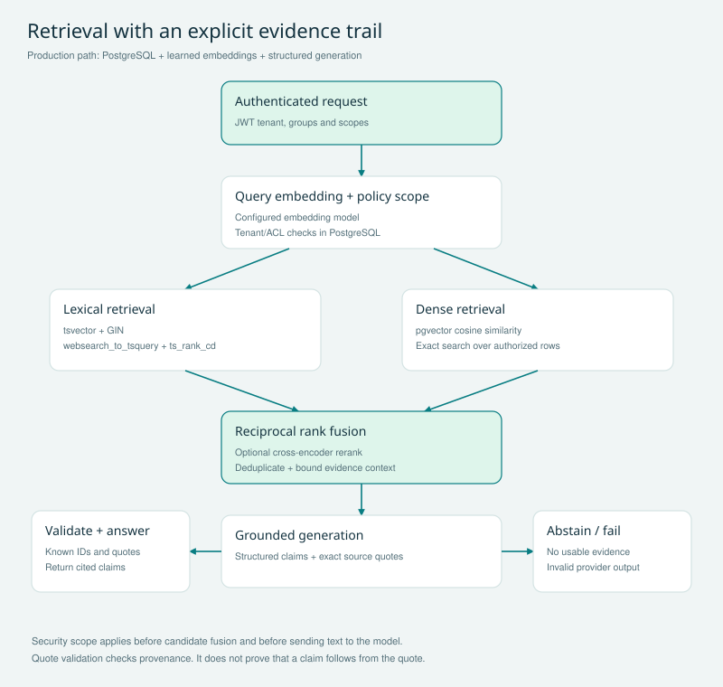

# HybridForge RAG

**Evidence-first hybrid retrieval for enterprise knowledge.**

A complete Python project with an API, browser workbench, PostgreSQL adapter, offline demo, tests, evaluation runner, diagrams and operational documentation. Designed for production engineering; **not certified production-ready or deployed**. Read [the validation report](docs/VALIDATION.md) and [release gates](docs/PRODUCTION_READINESS.md) before using real data.



## What it does

| Capability | Implementation |
|---|---|
| Hybrid retrieval | PostgreSQL full-text search + pgvector cosine similarity |
| Rank fusion | Reciprocal rank fusion; per-source rank diagnostics |
| Optional reranking | Sentence Transformers cross-encoder adapter |
| Grounded generation | Real OpenAI-compatible embeddings and structured chat requests |
| Evidence checks | Every claim must cite a returned chunk and an exact source quote |
| Isolation | Verified OIDC tenant/group claims + PostgreSQL forced row-level security |
| Document lifecycle | Content fingerprints, version preconditions, atomic replace and delete |
| Resource controls | Body limits, bounded candidates/context, process-local quotas and concurrency |
| Operations | Health endpoints, Prometheus counters/histograms, optional OTLP traces |
| Developer experience | Browser workbench, OpenAPI schema, sample corpus, tests and CI |

**Precision matters:** PostgreSQL `ts_rank_cd` is not BM25. The offline adapter uses Python BM25 and deterministic hash vectors; its dense branch is **not semantic search**. Production mode uses real embeddings. Citation checks do not establish semantic entailment or eliminate prompt injection.

## Run locally in five minutes

Requires Python 3.12+. No model account, Docker or database server is needed for the offline demo.

```bash
python -m venv .venv
source .venv/bin/activate
python -m pip install --require-hashes -r requirements-dev.lock
python -m pip install --no-deps -e .
export DEMO_TOKEN="$(python -c 'import secrets; print(secrets.token_urlsafe(32))')"
uvicorn hybridforge.api:create_app --factory --host 127.0.0.1 --port 8000 --no-access-log
```

In a second terminal, activate the same environment and export the **same token**:

```bash
export DEMO_TOKEN='paste-the-token-you-generated'
python scripts/seed.py
```

Open **http://127.0.0.1:8000**, paste the token in Session token, and select **Load collection**. Try `ERR_BRIDGE_042`, `rollback canary`, and `password rotation`. The token stays in the page's memory; it is not placed in localStorage, URLs or cookies. The demo token is a tenant administrator and can see all six fictional documents, including the restricted example. Use the ACL tests to demonstrate a reader's narrower permissions.

```bash
curl http://127.0.0.1:8000/v1/query \
  -H "Authorization: Bearer $DEMO_TOKEN" -H 'Content-Type: application/json' \
  -d '{"question":"ERR_BRIDGE_042","mode":"hybrid","top_k":5}'
```

### Docker demo

```bash
export DEMO_TOKEN='local-demo-token-change-me'
docker compose up --build -d
docker compose exec demo python scripts/seed.py
```

The demo binds only to loopback and persists SQLite data in a named volume. Use the same token in the browser. `docker compose down` stops it; `docker compose down -v` also deletes demo data.

## Validation

```bash
pytest -q
ruff check .
ruff format --check .
python scripts/evaluate.py
# Disposable PostgreSQL integration environment:
docker compose -f compose.postgres.yaml run --build --rm tests
docker compose -f compose.postgres.yaml down -v
```

Three PostgreSQL tests skip if `TEST_DATABASE_URL` is absent. A skipped test is not a successful database check. The synthetic evaluation compares lexical, dense and hybrid document recall, MRR and nDCG; it does not measure production semantic quality.

## Real model + PostgreSQL mode

1. Provision PostgreSQL 17 with pgvector >=0.8; use separate migration and application roles.
2. Set `MIGRATION_DATABASE_URL` and a strong `RAG_DB_PASSWORD`, then run `python scripts/migrate.py` once. The script installs schema v1 and creates/grants `rag_app`. Existing role passwords are not rotated.
3. Set `RAG_MODE=production`, `DATABASE_URL` for `rag_app`, `OPENAI_API_KEY`, `OIDC_ISSUER`, `OIDC_AUDIENCE` and `OIDC_JWKS_URL`. Use `sslmode=verify-full` with a trusted database CA. See [.env.example](.env.example).
4. Configure the identity provider to issue **RS256 access tokens** with `sub`, `iss`, `aud`, `iat`, `exp`, `tenant_id`, a `groups` array and space-delimited `scope` claims. Issue `rag:read`, `rag:write`, and `rag:observe` separately.
5. Run the API behind your TLS gateway. Use a real access token as `RAG_TOKEN` for `scripts/seed.py`, or ingest approved documents through the API. Seeding transmits fictional source text to the model provider and may incur charges.
6. Run the live evaluation: `python scripts/evaluate.py --api-url https://your-rag-host --output evals/live-results.json` after seeding. Then validate on a representative held-out corpus.

The PostgreSQL schema fixes vectors at 1536 dimensions. Model or dimension changes require a deliberate reindex/migration. Provider model defaults are configuration choices, not guarantees of account availability. The adapter expects the OpenAI embeddings and Chat Completions structured-output contracts; other providers may differ.

### Optional cross-encoder

```bash
pip install '.[rerank]'
export RERANKER=cross_encoder
```

This optional dependency group is not included in the validated lockfiles. Qualify and lock a compatible version before release. Download the model from a trusted source during image preparation, record its revision and license, and avoid runtime downloads. It has not been executed in this delivery.

## Six demo journeys

| Journey | Action | What to inspect |
|---|---|---|
| Exact identifier | Query `ERR_BRIDGE_042` | Lexical rank, matching recovery evidence |
| Meaning-based discovery | In real-provider mode ask `How do we recover lost database changes?` | Dense candidates vs lexical candidates; manually judge relevance |
| Retrieval comparison | Run the same question in all three UI modes | Rankings and evidence; do not assume hybrid always wins |
| Authorization | Run group/tenant isolation tests | Restricted chunks never reach the generator |
| Safe reindexing | Update with `expected_version=1`; retry stale version | Atomic replacement and HTTP 409 |
| Untrusted generation | Run invalid-citation/provider-failure tests | HTTP 502 or explicit abstention instead of an unchecked answer |

## Documentation map

- [Architecture and retrieval algorithms](docs/ARCHITECTURE.md)
- [API and integration contract](docs/API.md) / [OpenAPI snapshot](docs/openapi.json)
- [Security and threat model](docs/SECURITY.md)
- [Operations and incident runbook](docs/OPERATIONS.md)
- [Evaluation design](docs/EVALUATION.md)
- [Architecture decisions](docs/DECISIONS.md)
- [Production release gates](docs/PRODUCTION_READINESS.md)
- [Validation evidence](docs/VALIDATION.md)
- [Design references](docs/REFERENCES.md)
- [PDF architecture handbook](docs/HybridForge_Architecture_Handbook.pdf)

## Boundaries

Text/Markdown ingestion is implemented through a JSON API. PDF/OCR parsing, crawling, external connectors, durable asynchronous ingestion, source-version archives, conversation memory, distributed quotas, semantic entailment judges and global ANN retrieval are not implemented. The v1 PostgreSQL dense branch intentionally performs exact search over an authorized subset; benchmark before choosing corpus limits. Do not expose demo mode publicly or use its token model for customers.

### Rebuild the handbook and diagrams

Install `requirements-docs.txt` in a documentation environment and run `python scripts/build_handbook.py`. The generated PDF and four SVGs are already included. Mermaid sources are in `docs/diagrams/`. The documentation dependency is separate from the serving/runtime locks.
