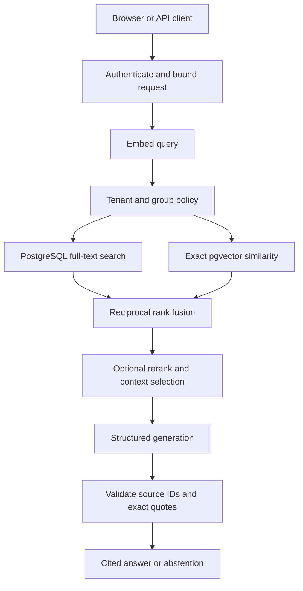
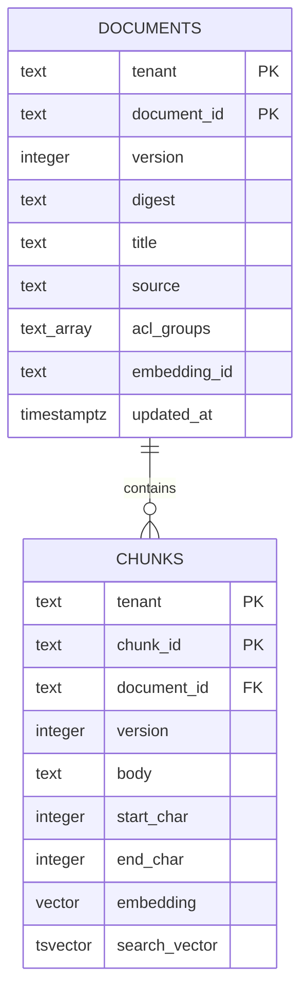
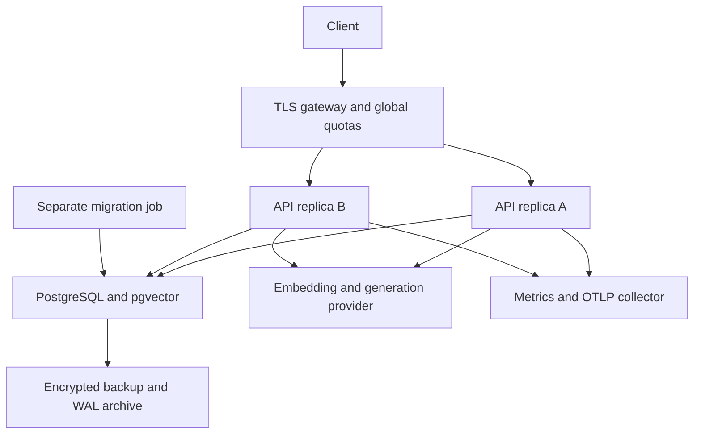

# Architecture and implementation notes

## 1. Problem and scope

An internal knowledge assistant must handle exact identifiers, conceptual questions and authorization simultaneously. A dense-only retriever may miss rare codes; a lexical-only retriever may miss paraphrases. HybridForge searches both representations and merges their ranks. The system is a synchronous, stateless application tier over one transactional data store. It does not require a multi-agent workflow to perform this bounded task.

Production assumptions: a trusted identity provider owns tenant membership and groups; the API and database roles are trusted service components; clients and retrieved documents are untrusted; approved document text may be sent to the configured external model provider. The reference workload is small-to-medium authorized corpora. No throughput or corpus-size capacity claim is established.

## 2. Request path

Both SQL searches execute sequentially within a repeatable-read transaction. This provides one retrieval snapshot and avoids permission/content inconsistency between branches. Generation takes place outside the database transaction. A permission change committed after retrieval does not revoke evidence already loaded into an in-flight request. If that behavior is unacceptable, implement reauthorization before response plus a revocation strategy for in-flight requests.

## 3. Ingestion and atomicity

The input is a bounded JSON document with caller-chosen identifier, title, source label, text, ACL groups and expected version. Tenant identity is absent from the body and comes only from the verified principal. The API permits writes only for `rag:write`, which grants tenant-wide document administration.

The service hashes canonical document fields plus the embedding identity. It splits the original text into approximately 1,200-character chunks with 180-character overlap, preferring a whitespace/newline boundary in the latter half of the window. Original character offsets are retained. This is character chunking, not a token-aware or layout-aware parser. Each chunk ID hashes document ID, fingerprint and start offset.

Embeddings are obtained in batches of at most 32 before opening the write transaction. Inside the transaction, a per-tenant/document advisory lock serializes replacements. Identical fingerprints return the existing version even if a retry still carries the original expected version. Changed content requires the current version. The old document and cascading chunks are removed and the replacement inserted atomically. If embedding or insertion fails, readers retain the prior committed document.

Version numbers identify the currently committed revision. Historical source bodies are not archived. Answers carry the version and exact quote, but an old chunk cannot be fetched later after replacement. An immutable source archive is a release requirement for regulated retention needs.

## 4. Retrieval and scoring

**PostgreSQL lexical branch.** A generated tsvector weights title terms A and body terms B. A GIN index supports matching. `websearch_to_tsquery('english', question)` parses the input and `ts_rank_cd` ranks matches. This parser can require all unquoted terms, which is restrictive for long natural-language questions. It also interprets OR and negation. Evaluate query normalization or an alternate lexical backend on your data; neither is silently implemented here.

**PostgreSQL dense branch.** Cosine similarity is `1 - (embedding <=> query_vector)`. The query materializes only the RLS-authorized tenant/model rows, then sorts exactly. This favors correctness and predictable authorization over approximate index performance. An ANN index alone will not accelerate this materialized-subset query. For large corpora, design and validate tenant partitioning or an ANN query with iterative scans and filtered-recall tests.

**Offline branch.** SQLite stores document/chunk JSON and vectors. Authorization precedes Python BM25 and exact cosine scoring. BM25 statistics are computed over the authorized corpus. Hash vectors give deterministic lexical overlap behavior, not learned semantics. PostgreSQL lexical ranking uses corpus-wide index structures and is not identical to the offline BM25 reference.

**Fusion.** For each unique candidate chunk, score = sum over retrieval branches of `1 / (60 + rank)`, with ranks starting at one. Branch weights are equal. Raw BM25, ts_rank_cd and cosine scores are never added together. Ties resolve by stable chunk ID. In lexical-only/dense-only diagnostics, the unused branch is omitted from fusion, though both branches still execute against the same snapshot.

**Reranking.** If enabled, a cross-encoder scores the top candidate_k fused chunks for question-passage relevance. Context selection removes passages overlapping a selected passage by more than 50 percent of their own span, respects top_k and enforces a 16,000-character evidence budget. The API bounds top_k to 12 and candidate_k to 100. Generation output is bounded to 1,800 completion tokens.

A dense cosine threshold of 0.25 is a configurable starting point, not a calibrated confidence score. RRF scores are relative ranking values, not answer probabilities. Lexical-only evidence can still enter the context even when its dense score is below the threshold.

## 5. Data model

The schema also has a one-row schema_version table. Application startup requires schema v1, forced RLS on both content tables and a database role without superuser or BYPASSRLS privileges. Tenant/document foreign keys prevent cross-tenant chunk attachment. No UPDATE privilege is needed; versioned replace is DELETE + INSERT.

## 6. Generation contract and limits

The provider receives the question and only the selected authorized text. Retrieved evidence is labeled untrusted in the system message. The structured response contains claims with text, chunk_id and an exact quote. The service validates every claim against the current retrieval result. Any invalid claim rejects the whole generated answer. Empty claims or no retrieval evidence result in an abstention.

This validation proves that a cited quote occurs in a retrieved chunk. It does not prove the claim follows from the quote, that the source is correct, or that a model ignored every injection. Do not label the system hallucination-free. Production quality evaluation must include entailment, answer completeness, contradictory documents and adversarial evidence.

## 7. Deployment topology

Gateway, database hosting, backups, secret store, identity provider and telemetry collector are operator-provisioned infrastructure. Kubernetes manifests describe the application tier only. They are templates, not evidence that these external systems exist.

## 8. Module ownership

| Module | Responsibility |
|---|---|
| api.py | HTTP, authentication dependencies, admission limits, status mapping |
| security.py | OIDC verification and bounded local quotas |
| service.py | Ingest/retrieve/generate workflow and citation validation |
| retrieval.py | Chunking, fingerprints, BM25 reference, cosine, RRF, context selection |
| providers.py | Offline adapter, real HTTP model adapter, optional cross-encoder |
| storage.py | SQLite demo and PostgreSQL transactions/queries |
| observability.py | Bounded-label metrics and opt-in tracing |
| migrations/ | Schema, constraints, indexes and RLS policies |
